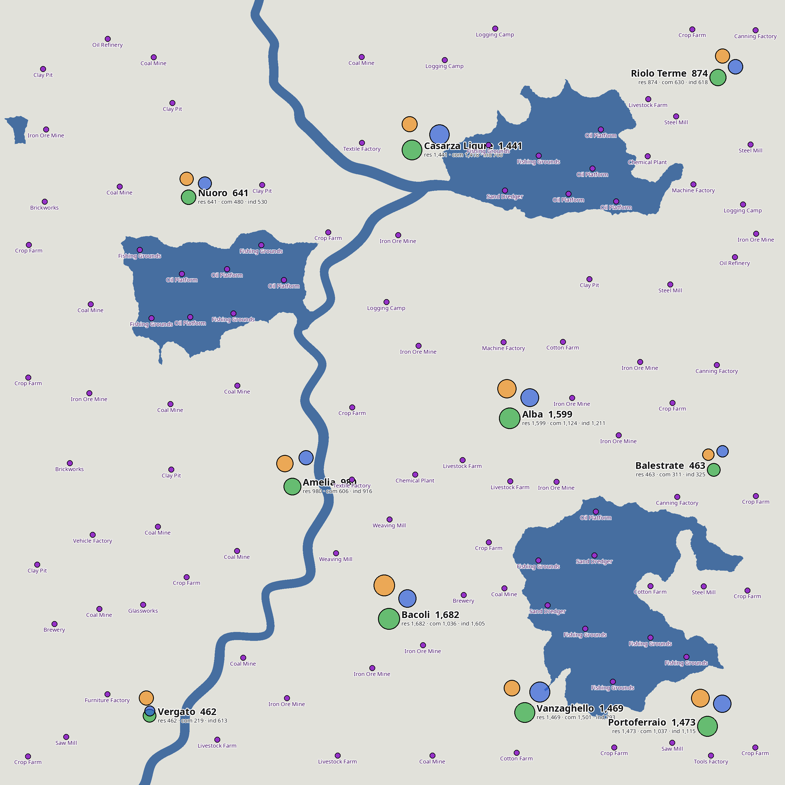

# Fever Calculator — save-file research

Goal: a browser tool where a player uploads a Transport Fever 3 (TF3) `.sav`, sees a map of
water, town centres and industries, and draws/plans cargo routes between them.
Everything is read from the raw save file. **No game mod.**

**Design rule: never identify or link anything by name.** Players can rename towns,
industries, stations, everything. Linking and placement use only data players can't change:
entity ids, the town id on each TownBuilding, construction file paths (types), positions and
terrain. Names are display-only: town names come from the NAME table by town-id order,
and industries are labelled by type. Player-built things (depots, stations, warehouses, lines)
are irrelevant to the map and ignored.

Status (2026-10-16): the format is understood well enough to extract everything the map needs.
`scripts/fever_extract.py` reproduces all results from a `.sav` in ~10 s using only
structure-based search (no hard-coded offsets, no name anchors). Verified on **two independent
games** (`2.sav` Italian names, `1.sav` Swedish names), TF3 build **25754343**.
Nothing ported to JS yet.



---

## 0. Quick start (reproduce everything)

```bash
cd ~/Work/fever-calculator/research
S=~/.local/share/Steam/userdata/65268742/3493540/local/save
uv run -q --with zstandard,pillow python -I scripts/fever_extract.py $S/2.sav output/2sav --hex
#   -> output/2sav/{world.json, offsets.json, water.png, height.png, map.png, HEX_SAMPLES.md}
```

Expected console output for `2.sav`:

```
decompressed 391,675,186 bytes
industries 105, town buildings 4790
NAME table: 17241 entries at 149664617
towns 10 ids 31366..31375, TownBuilding records 4790 at 372308708
heightmap 1936 tiles of 65x65 at 355917448
  Bacoli           id 31370  pop  1682  buildings 722   … (10 towns)
```

`HEX_SAMPLES_2sav.md` and `HEX_SAMPLES_1sav.md` (generated with `--hex`) contain real hex
dumps of every structure below, with offsets. Read them next to this document.

---

## 1. Container

- Saves: `~/.local/share/Steam/userdata/<steamid>/3493540/local/save/*.sav` (native Linux
  build; 3493540 = TF3 Steam app id). Each has a `.jpg` screenshot next to it.
- `.sav` = **Zstandard** frame (magic `28 b5 2f fd`, no dictionary). `2.sav`: 98.8 MB →
  391,675,186 bytes. `1.sav`: → 222,252,152 bytes.
- Decompressed data starts with magic **`tf**`** (`74 66 2a 2a`), a few header u32s/floats,
  then a Lua table with `company.level`, then the **active mod list** as strings:
  `zhenya_auto_color_lines`, `mod.io`, `6416672`, `Auto Color Lines`, `https://mod.io/g/…`
  (id, source, mod.io id, display name, URL).
- General encoding: **little-endian**. Strings = `u32 length` + UTF-8 bytes (no terminator).
  Entity references = `u32` entity id. Script state = serialized Lua values (§2).

## 2. Serialized Lua values

| tag (u32) | payload |
|---|---|
| 1 | bool, `u8` |
| 2 | number, `f64` (integers are stored as doubles too) |
| 3 | string, `u32 len` + bytes |
| 4 | table: `u8 flag` (always 1 seen) + `u32 count` + count × (key value) |

A **top-level** params table (directly after a construction file name) has no tag and no
flag: `u32 count` + entries. Keys are values too (strings, or numbers for arrays).
Example (oil refinery params):
`04000000 | 03000000 0f000000 "productionLevel" 02000000 <f64 0> | 03000000 04000000 "seed" 02000000 <f64> | …`.
Parser: `lua_table` / `lua_value` in `scripts/fever_extract.py`.

## 3. Constructions (industries + town buildings)

```
u32 len, fileName        e.g. "industries/saw_mill/saw_mill.con"
params                   top-level Lua table (§2)
Mat4f transf             16 × f32; floats [0..15]; m[10]=1, m[15]=1, m[3]=m[7]=m[11]=0
                         translation = m[12], m[13], m[14] → x, y, z (metres)
                         rotation about z only: m[0]=cos, m[1]=sin, m[4]=-sin, m[5]=cos
i64 timeBuilt            (game ms)
…entity lists            frozen nodes/edges, depots, stations, then e.g. "base" → model entity
```

- Records do **not** contain their own entity id.
- **Locate** with regex `(industries|buildings)/[A-Za-z0-9_/]+\.con`, keep matches whose
  preceding u32 equals the string length, parse params, and require the transform checks
  above. That rejects duplicate path strings elsewhere (e.g. `stations/…con` copies in
  proposal/history data have a `u32 hash` before the params, so they fail to parse).
- All construction records are in one region (`2.sav` 181.85–191.60 MB; `1.sav` from 94.90 MB),
  in entity order, mixed together (industries, buildings, stations, depots, …).
- **Industries**: `2.sav` 105, `1.sav` 51. Type = path segment 2 (`saw_mill`).
  Params: `productionLevel, seed, sizeFactor, year, upgrade?, modules?` (farms and oil
  platforms have big `modules` tables). Water industries (oil platform, fishing grounds) have z = 0.
  Four `industries/…con` strings in `2.sav` have no length prefix. They're not records; skip them.
- **Town buildings**: `2.sav` 4,790, `1.sav` 1,972. Path
  `buildings/<era>/<kind><level>/<WxD_nn>/<file>.con`, e.g. `buildings/a/r1/3x4_03/a_res_l1_3x4_03.con`.
  `kind` = first letter of segment 3: **r**esidential / **c**ommercial / **i**ndustrial.
  Params: `capacity` (people/jobs; used for town size), `width, depth, parcelFace, cargoTypes,
  seed, upgrade?`.
- **Town cargo needs** (2026-10-17): `cargoTypes` is a Lua array of `{ "::/cargos/<x>/<x>.cargo", factor }`.
  Residential buildings have `{}`. In both saves, every commercial (or industrial) building of a town
  lists the same cargos in the same order: the town's need list for that land use (the `Town` component's
  `cargoNeeds`, grown by `game_mechanics/towns/town_growth.script.tl` as the town levels up). The first
  cargo has factor 1, later ones 0.5 or 0.25; how the engine uses the factor is not verified.
  A few buildings per kind have `{}` (probably built before the town had needs). `2.sav` Bacoli:
  commercial = meat 1, tinned_food 0.5, clothes 0.5; industrial = planks 1, machines 0.5, vehicles 0.25.
  Parsed in `src/parser/towns.ts` (`demand`); not in the Python reference.
- Other path prefixes present (ignored): `stations/`, `depots/`, `warehouses/`,
  `infrastructure/`, `landmarks/`.

## 4. NAME table (entity names)

- One array of **all entity names, in entity-id order**:
  `… u32 1, u32 15137, u32 count` then `count` × (`u32 len` + UTF-8).
  `2.sav`: count at **149,664,617**, 17,241 entries. `1.sav`: count at **78,000,055**, 7,104 entries.
- Order: [0] player company (`XysteR Transport`), **[1..T] the towns**, then industries,
  persons, vehicles, stations, signals… Unnamed entities = literal `"no name"`.
- **Locator (name-independent)**: find all `07 00 00 00 "no name"`, take the densest run
  (gaps < 8 KB), walk backwards string-by-string (find q with `q + 4 + u32(q) == p`)
  until no valid string precedes; the u32 before the first string is the count.
- This table is the **only full copy** of town names. Partial copies exist in town
  notification state (§5), but they're snapshots, so ignore them.
- Renaming a town changes the string here, and the tool picks it up. Linking is by id
  (§5), so renames never move labels.
- Not used for industries: renameable, and the town prefix in industry names isn't the nearest
  town. Industries are labelled by type (§7).

## 5. Towns

There is **no stored town-centre position** (searched). Method:

1. **Town ids** from town-rating script state. Byte pattern:
   `"townEntity" 04000000 01 02000000 03000000 06000000 "entity" 02000000 <f64 id>`.
   `2.sav`: ids 31366–31375 (first at 380,494,185). `1.sav`: 32428–32437.
   Sorted ids ↔ NAME[1..T]. Cross-check in `2.sav`: notification `townName = "Alba"` has
   id 31369 = NAME[4] ✓.
   **Not every town has one** (2026-10-17): fresh games `test3/4/5.sav` have 1 of 5, 1 of 16 and
   2 of 21. Town ids are consecutive, so the TS parser only uses these as seeds and takes the
   full id list from the TownBuilding records (step 2), searching the seeds' 256-id blocks and
   any neighbouring block the ids reach. The Python reference still uses these ids only.
2. **TownBuilding component records** (one per town building; API fields
   personCapacity, stockList, construction, level, parcels, depth, height, town, timeBuilt).
   Signature used: `u32 depth ∈ 1..4, f32 height ∈ (2, 300), u32 townId ∈ ids` (then i64
   timeBuilt). Records are ~45–55 bytes apart; keep the densest contiguous run.
   `2.sav`: first at **372,308,708**, exactly 4,790 (= building constructions).
   `1.sav`: first at **211,931,517**, exactly 1,972.
   Example (`2.sav`): `04000000 | f2570200 8e580200 88590200 8f590200` (4 parcel ids) then
   `04000000` depth=4, `fa6d5b41` height=13.71, `8b7a0000` town=31371,
   `003e880200000000` timeBuilt.
   Just before `depth` is `u32 nParcels, nParcels × u32 parcel id`. **nParcels × depth equals the
   `WxD` in the building's path** (`3x4_03` → 3×4), checked on every building of 5 saves. The
   first u32 of a record is an entity id, not personCapacity (an earlier guess).
3. **Cluster** building positions by single linkage (start at 180 m; try 150, 210, 120,
   250, 100, 300, 80, 400 until the sorted cluster sizes equal the sorted TownBuilding
   per-town counts). Then pair clusters with towns by size.
   - `2.sav` counts: 722, 680, 646, 636, 587, 490, 320, 271, 233, 205 (180 m works).
   - `1.sav` counts: 348, 291, 241, 206, 200, 181, 162, 143, 112, 88 (180 m works).
   - TownBuilding order ≠ construction order (tested: mapping by index is wrong).
   - Python: fails if two towns have equal counts (the script warns) or towns have merged
     (sizes never match, so the script exits).
   - **TS parser:** pairs clusters with towns by their histogram of footprints (`WxD` per building
     vs nParcels×depth per TownBuilding record), which is distinct for every town in all saves
     seen, including `test4/5.sav` where sizes tie. If no radius matches exactly, it keeps the
     closest one when ≤ max(4, 1%) buildings differ, and warns: `autosave_2_1952-04-24.sav` has
     4,752 records but 4,751 buildings (one in Bacoli), probably saved mid-build.
4. Per town: **three centres** = mean x,y of its residential / commercial / industrial
   buildings; **capacity** per kind = sum of `capacity`. **Population = residential capacity**,
   which is what the game's town HUD shows (`gui/main/town_hud_react_util.tl`). User accepted
   this as good enough; not checked against the in-game number.

`2.sav` results:

| Town | id | Pop (res) | Com | Ind | Buildings |
|---|---|---|---|---|---|
| Bacoli | 31370 | 1,682 | 1,036 | 1,605 | 722 |
| Alba | 31369 | 1,599 | 1,124 | 1,211 | 587 |
| Portoferraio | 31371 | 1,473 | 1,037 | 1,115 | 636 |
| Vanzaghello | 31372 | 1,469 | 1,501 | 793 | 680 |
| Casarza Ligure | 31367 | 1,441 | 1,418 | 700 | 646 |
| Amelia | 31373 | 980 | 606 | 916 | 490 |
| Riolo Terme | 31368 | 874 | 630 | 618 | 320 |
| Nuoro | 31374 | 641 | 480 | 530 | 271 |
| Balestrate | 31375 | 463 | 311 | 325 | 205 |
| Vergato | 31366 | 462 | 219 | 613 | 233 |

Full data incl. centre coordinates: `output/2sav/world.json`, `output/1sav/world.json`.

## 6. Terrain / water

Layout (`2.sav` list at **355,917,448**, data at 355,940,720, end 372,307,664;
`1.sav` list at 195,540,429):

```
… f32 299.86, f32 4044.43, f32 322.24, f32 4066.93, …   (meaning unknown)
u32 N (=1936 = 44×44), u32 2
N × (i32 tileX, i32 tileY, u32 v)     tile coords −22..21; v = 2 for all but the last tile (0)
u32 0, u32 N, u32 0xFFFFFFFF, u32 14, u32 0, u32 0, u32 0, u32 N
N × (u32 S (=4225 = 65²), S × u16 raw height)
```

- Each tile is **256 m** with **65×65** samples (4 m spacing, neighbouring tiles share
  their edge), **row-major** (`index = iy*65 + ix`). Tile (tx, ty) covers
  x ∈ [256·tx, 256·tx+256], y likewise; **+y = north** (image rows must be flipped).
  `2.sav` extent: −5632…+5632 m both axes. Both tested saves are 44×44 tiles.
- **height_m = raw / 20 − 100**. Fitted against all 105 industry z values: exact to ±0.1 m
  (e.g. raw 2040 → 2.0 m farm, 4563 → 128.2 m mine).
- **Water = raw < 2000** (water level 0 m). Lake floors ≈ raw 6 (−99.7 m); rivers −6…−9 m.
  Lowland peaks at raw 2000–2060.
- **Locator**: lookahead regex
  `(?=\xff\xff\xff\xff.{4}\x00{12}(N:.{4})(S:.{4}))` with S a perfect square, the two u32
  before = (0, N), the list before that with header (N, 2), unique tile coords, then N
  contiguous `u32 S + samples`. Use a lookahead: plain `finditer` skipped the real match
  because an earlier overlapping match consumed it.
- Assumptions: water level 0 (the Terrain component has `waterLevel`; not located), tile
  size 256 m (consistent so far).

## 7. Industry metadata (from game files, not the save)

- `data/industry_chains.json`: inputs/outputs per industry type, parsed from base-game
  `industries/*/*.con.lua` (`type = "INPUT_STOCK"/"OUTPUT_STOCK"`, `cargoType = "::/cargos/<x>/<x>.cargo"`).
  For raw producers the "input" (tools/machines/fertilizer) is a production booster.
- `data/industry_names_en.json`: type → English name, via `_("INDUSTRIES_<X>_NAME")` in each
  `.con.lua` looked up in `base/strings/en/LC_MESSAGES/base.mo` (gettext; other languages
  in sibling folders). E.g. `food_factory` → "Canning Factory", `forest` → "Logging Camp".
- Base sources are zipped inside the game. They were extracted to `~/.cache/tf3-base/25754343/`
  with the `tf3-modding` skill (`~/.claude/skills/tf3-modding/scripts/tf3_api.py index`).
  The typed API is in `<game>/api/tealdef/api/engine.d.tl` (e.g. `record TownBuilding`,
  `record Terrain`, `UtilTerrain.getHeightAt`).

## 8. How the images were made

All are produced by `images()` in `scripts/fever_extract.py` (needs pillow).
`images/` holds the first versions made during research; `output/<save>/` holds the
script's reproducible versions.

- **water.png**: every 2nd heightmap sample (1 px = 8 m, 1408² for a 44-tile map),
  grey 60 if raw < 2000 else 225. Rows flipped so north is up.
- **height.png**: same raster, raw values linearly stretched min…max to 0…255.
  (The research-time version in `images/` used every 4th sample, 704².)
- **map.png**: every sample (1 px = 4 m, 2816² for 44 tiles). Layers:
  - background: water RGB (70,110,160), land (225,225,218)
  - projection: `px = (x − x_min)/4`, `py = H − 1 − (y − y_min)/4`, with
    x_min = y_min = 256·min tile (−5632 here)
  - town centres: residential **green** (40,170,60), commercial **blue** (40,90,220),
    industrial **orange** (240,140,20); alpha 170; black 3 px outline;
    **radius = 8 + 0.75·√capacity** px
  - town label at the residential dot: `"<name>  <population>"` (Noto Sans Bold 34 px,
    3 px white stroke) and below it `res … · com … · ind …` (Noto Sans Regular 20 px). Placed right of the
    dot; flipped to the left when the dot is within 600 px of the right edge.
  - industries: **purple** (150,50,200) dots, radius 10, 2 px outline; label = English type
    name centred below (Noto Sans Regular 20 px, colour (70,20,100), 2 px white stroke)
  - Fonts: `/usr/share/fonts/noto/NotoSans-{Bold,Regular}.ttf`, falling back to DejaVu, then the PIL default.
- Known cosmetic issue: some town labels overlap industry labels (Casarza Ligure, Amelia).

## 9. Dead ends (don't retry)

- Matching industry names to towns, or placing anything by name: renameable, unreliable.
- Station/depot name alignment to label town clusters: superseded by TownBuilding.
- Scanning for town bounding boxes (6 × f32): far too noisy.
- Searching for a stored town-centre position: none found.
- Mapping TownBuilding to construction records by index: orders differ.
- A game mod exporting JSON via `api.engine` would work, but the user rejected mods.
- Hard-coded anchors (the first prototype found the NAME table via "Vergato Train Depot"):
  replaced by the "no name" locator.

## 10. Decisions, environment, open questions

**User decisions**
- Name **Fever Calculator**; project root `~/Work/fever-calculator`.
- Browser tool: upload `.sav`, parse client-side, nothing uploaded. No mod.
- v1 map: water vs land (heightmap shading later), town centres, industries.
  Roads/rails/stations/lines out of scope.
- Three centres per town + sizes; colours as in §8; industries labelled by type.
- Not decided: per-person plans (localStorage + JSON export) vs shared between viewers;
  where to host.

**Environment (this machine)**
- Game: `~/.local/share/Steam/steamapps/common/Transport Fever 3/` (build 25754343, native Linux).
- Saves: `~/.local/share/Steam/userdata/65268742/3493540/local/save/`:
  `2.sav` (analysed; ~1952), `autosave_2_1941-06-07 … 1952-04-24.sav` (same game over time,
  good regression set), `1.sav` (second game; verified working).
- System `python3` lacks numpy/pillow/zstandard → `uv run -q --with zstandard,pillow python -I …`.
  `zstd` CLI exists. Node 26 (`zlib.zstdDecompressSync`) and deno are installed.

**Offsets summary** (decompressed; they move between saves; the script finds them):

| structure | 2.sav | 1.sav |
|---|---|---|
| decompressed size | 391,675,186 | 222,252,152 |
| NAME count u32 | 149,664,617 | 78,000,055 |
| first industry record | 181,852,117 | 94,902,470 |
| first building record | 181,869,374 | 94,924,379 |
| heightmap tile list | 355,917,448 | 195,540,429 |
| heightmap samples | 355,940,720 | 195,563,701 |
| first TownBuilding | 372,308,708 | 211,931,517 |
| first townEntity | 380,494,185 | 215,910,232 |

**Unverified / risks**
- Map sizes other than 44×44 tiles, other climates, other game languages (is `"no name"`
  localized?) and future game builds.
- Water level fixed at 0 m.
- Town ↔ cluster pairing by size (see §5 step 3 and the lead in step 2).
- Saves with no town-rating state (no `townEntity`) would yield no town ids. Not seen yet.
- Player-built industries aren't distinguished (harmless).

## 11. Files

```
research/
  FINDINGS.md               this document
  HEX_SAMPLES_2sav.md       hex dumps of every structure in 2.sav (with offsets)
  HEX_SAMPLES_1sav.md       same for 1.sav
  scripts/
    fever_extract.py        reference extractor: .sav → world.json, offsets.json, images, hex samples
    prototypes/             exploration scripts from the research session (superseded; they
                            expect a decompressed save at sav/2.raw)
  output/2sav/, output/1sav/  world.json, offsets.json, water.png, height.png, map.png
  images/                   first research renders (map.png, water.png, height.png)
  data/
    industry_chains.json    inputs/outputs per industry type
    industry_names_en.json  type → English name
    intermediate/           prototype outputs for 2.sav: names.json (NAME array),
                            extract.json (industries + buildings [x,y,capacity,kind]),
                            tb.json ([offset, townId, depth, height]), hm.json (tiles + offsets)
```

`world.json` schema: `terrain{tile_m, samples_per_tile, sample_m, tiles_x, tiles_y, extent_m,
height_formula, water}`, `towns[{id, name, buildings, cluster_radius_m,
centers{residential,commercial,industrial:[x,y]}, capacity{…}, population}]`,
`industries[{type, x, y, z}]`.

## 12. Next steps

1. Port `fever_extract.py` to JS in a Web Worker: zstd (e.g. `fzstd`), byte search helpers,
   Lua-value parser, constructions, NAME, townEntity, TownBuilding, heightmap. The Python
   script is the reference; compare JSON output on both saves.
2. Try the TownBuilding → construction-entity lead (§5.2) to drop size matching.
3. Map UI: water layer (+ optional hillshade), town centres, industries with supply-chain
   hover, route drawing with distances, plans per save with JSON export/import.
4. Test more saves: other map sizes, climates, languages; the autosave series.
5. Later: roads/rails, existing lines, town cargo demand, industry production levels.
